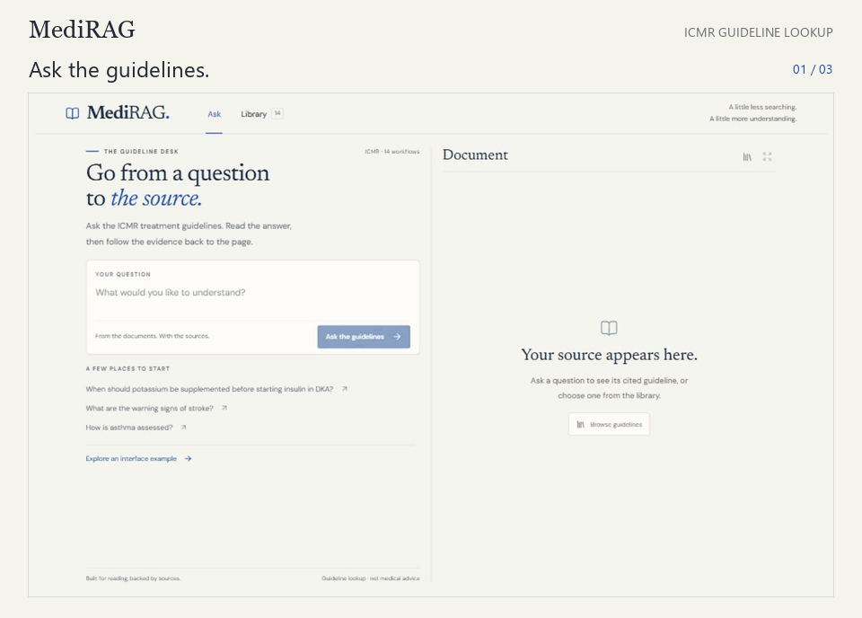
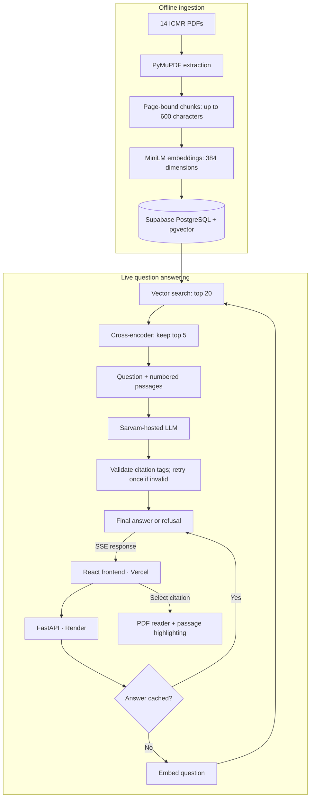

# MediRAG

RAG over ICMR Standard Treatment Workflows: answers clinical questions with
document and page citations, refuses when the guidelines don't cover it, and
is measured on a 40-question eval set.

> Work in progress. A guideline lookup tool, not medical advice.

## Demo

Ask a question, read the cited answer, and check the highlighted passage in the original PDF.



[Watch the MP4](docs/assets/medirag-refined.mp4) · [Try the app](https://medirag-desk.vercel.app/)

Highlights locate retrieved passages, rather than independently verifying every answer claim.

## Architecture



Streamed text is provisional until the final result. Citation checks
validate source tags, not whether every claim is supported.
PDF imports currently support local preview only.

## Setup (Windows, PowerShell)

```powershell
py -m venv .venv
.venv\Scripts\Activate.ps1
pip install -r requirements.txt
copy .env.example .env            # fill in POSTGRES_PASSWORD, DATABASE_URL, SARVAM_API_KEY

docker compose up -d              # Postgres + pgvector on port 5433
python -m scripts.ingest          # parse, chunk, embed and store all PDFs
uvicorn app.main:app --reload     # http://127.0.0.1:8000/health
```
## Frontend

Keep FastAPI running on port 8000. In a separate terminal:

```powershell
cd frontend
npm ci
npm run dev
```

Open http://127.0.0.1:5173/. See `frontend/README.md` for details.

## Layout

| Path | What |
|---|---|
| `DESIGN.md` | Design decisions and evaluation plan |
| `docs/BUILD_LOG.md` | What was built, in order, and why |
| `data/pdfs/` | 14 ICMR STW PDFs |
| `data/sources.csv` | Official URL and edition of each PDF |
| `db/schema.sql` | Tables |
| `app/` | API code |
| `scripts/` | Ingestion and inspection scripts |
| `evals/questions.yaml` | 40 eval questions (30 dev, 10 held-out) |

## Dev baseline results

30 dev questions; 10 held-out questions were reserved until pipeline tuning finished.
Vector-only retrieval, 494 chunks, top 5; generator and judge: glm5.3.

| Metric | Result |
|---|---|
| Hit@5 | 27/27 (100%) |
| MRR@5 | 0.907 |
| Mean page coverage@5 | 100% |
| All-required-pages@5 | 27/27 |
| Correct refusals | 3/3 unanswerable |
| False refusals | 7/27 answerable |
| Raw LLM judge: correct / partial / incorrect | 14 / 5 / 8 |
| Manual review: correct / partial / incorrect | 15 / 4 / 8 |

Manual review changed three verdicts:

- **q08 and q17: partial → correct.** Both answered the question asked; the
  judge penalized omitted reference details beyond its scope.
- **q23: correct → partial.** Pain migration to the right iliac fossa was unclear.

All 27 answerable responses were manually reviewed. Page-level retrieval
scores do not establish complete evidence retrieval or answer correctness.
See `evals/results.md` for settings, evidence coverage and limitations.

## Held-out results — frozen reranked configuration

Vector top 20 → cross-encoder/ms-marco-MiniLM-L6-v2 → top 5.
Evaluated 10 held-out questions after dev tuning finished.

| Metric | Result |
|---|---|
| Hit@5 | 8/8 |
| MRR@5 | 1.000 |
| Mean page coverage@5 | 93.8% |
| All-required-pages@5 | 7/8 |
| Correct refusals | 2/2 unanswerable |
| False refusals | 3/8 answerable |
| Manually reviewed correct answers | 5/8 |

All 8 answerable responses manually reviewed. Page-level retrieval
does not establish complete evidence. See `evals/results.md` for
failures, wording caveats and evaluation limits.

The deployed app uses vector top 20 → cross-encoder reranking → top 5.

## Status

- [x] Design, data and evaluation set
- [x] Local PostgreSQL + pgvector in Docker
- [x] Extraction, chunking, embedding and storage: 494 chunks
- [x] Search and answers with citations and refusal
- [x] Dev baseline evaluation and manual answer review
- [x] Streaming, caching, usage logging, retries and model fallback
- [x] React frontend, PDF reader and citation highlighting
- [x] Hosted PostgreSQL + pgvector — Supabase setup
- [x] Deployment — [frontend](https://medirag-desk.vercel.app/) on Vercel, [backend](https://medirag-3xvf.onrender.com/) on Render
- [x] Dev baseline adjudication
- [x] Held-out evaluation after tuning

## Deferred tasks

- [ ] Searchable PDF uploads: backend upload/ingestion endpoint,
  connected frontend control and progress/error feedback.
  Current imports support local preview only.
