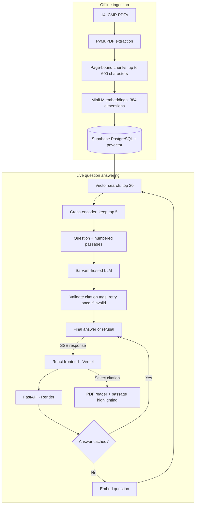

# MediRAG

Deployed clinical guideline assistant over **14 ICMR workflows and 494 chunks**,
with streamed answers, interactive PDF citations and passage highlighting.
Evaluated across **90 questions**; **82.5% answer correctness** on the latest
50-question supplementary test (33/40 answerable; 10/10 correct refusals).

> Work in progress. A guideline lookup tool, not medical advice.

## Demo

Ask a question, read the cited answer, and check the highlighted passage in the original PDF.


[Watch the MP4](docs/assets/medirag-refined.mp4) · [Try the app](https://medirag-desk.vercel.app/)

Highlights locate retrieved passages, rather than independently verifying every answer claim.

## Architecture



Streamed text is provisional until the final result. Citation checks
validate source tags, not whether every claim is supported.
PDF imports currently support local preview only.

## Setup (Windows, PowerShell)

```powershell
py -m venv .venv
.venv\Scripts\Activate.ps1
pip install -r requirements.txt
copy .env.example .env            # fill in POSTGRES_PASSWORD, DATABASE_URL, SARVAM_API_KEY

docker compose up -d              # Postgres + pgvector on port 5433
python -m scripts.ingest          # parse, chunk, embed and store all PDFs
uvicorn app.main:app --reload     # http://127.0.0.1:8000/health
```
## Frontend

Keep FastAPI running on port 8000. In a separate terminal:

```powershell
cd frontend
npm ci
npm run dev
```

Open http://127.0.0.1:5173/. See `frontend/README.md` for details.

## Layout

| Path | What |
|---|---|
| `DESIGN.md` | Design decisions and evaluation plan |
| `docs/BUILD_LOG.md` | What was built, in order, and why |
| `data/pdfs/` | 14 ICMR STW PDFs |
| `data/sources.csv` | Official URL and edition of each PDF |
| `db/schema.sql` | Tables |
| `app/` | API code |
| `scripts/` | Ingestion and inspection scripts |
| `evals/questions.yaml` | 40 eval questions (30 dev, 10 held-out) |
| `evals/fresh50/` | Frozen supplementary test: 50 questions, outputs and results |

## Evaluation

**Cross-encoder reranking raised dev answer correctness by 22.2 percentage points**
(55.6% → 77.8%) and reduced false refusals from 7/27 to 4/27.

| Evaluation | Answer correctness | Correct refusals | MRR@5 |
|---|---|---|---|
| Dev: vector baseline | 15/27 (55.6%) | 3/3 | 0.907 |
| Dev: reranked | 21/27 (77.8%) | 3/3 | 0.944 |
| Original held-out: reranked | 5/8 (62.5%) | 2/2 | 1.000 |
| Fresh 50: reranked | **33/40 (82.5%)** | **10/10** | **0.951** |

90 distinct questions: 30 dev, 10 original held-out and 50 supplementary.
Answer accuracy excludes unanswerable questions; refusals are scored separately.

Fresh 50 used frozen questions/settings, cache bypass, LLM judging and assistant
review of all outputs. Seven false refusals lacked complete retrieved evidence.
This same-corpus supplementary score is separate from the earlier held-out
result; it is not a matched before/after gain or independent clinical validation.

Deployed retrieval: vector top 20 → cross-encoder reranking → top 5.
Page-level hits do not establish complete evidence. See
[original evaluations](evals/results.md) and [fresh 50 results](evals/fresh50/results.md).

## Status

- [x] Design, data and evaluation set
- [x] Local PostgreSQL + pgvector in Docker
- [x] Extraction, chunking, embedding and storage: 494 chunks
- [x] Search and answers with citations and refusal
- [x] Dev baseline evaluation and manual answer review
- [x] Streaming, caching, usage logging, retries and model fallback
- [x] React frontend, PDF reader and citation highlighting
- [x] Hosted PostgreSQL + pgvector — Supabase setup
- [x] Deployment — [frontend](https://medirag-desk.vercel.app/) on Vercel, [backend](https://medirag-3xvf.onrender.com/) on Render
- [x] Dev baseline adjudication
- [x] Held-out evaluation after tuning
- [x] Frozen 50-question supplementary evaluation

## Deferred tasks

- [ ] Searchable PDF uploads: backend upload/ingestion endpoint,
  connected frontend control and progress/error feedback.
  Current imports support local preview only.
